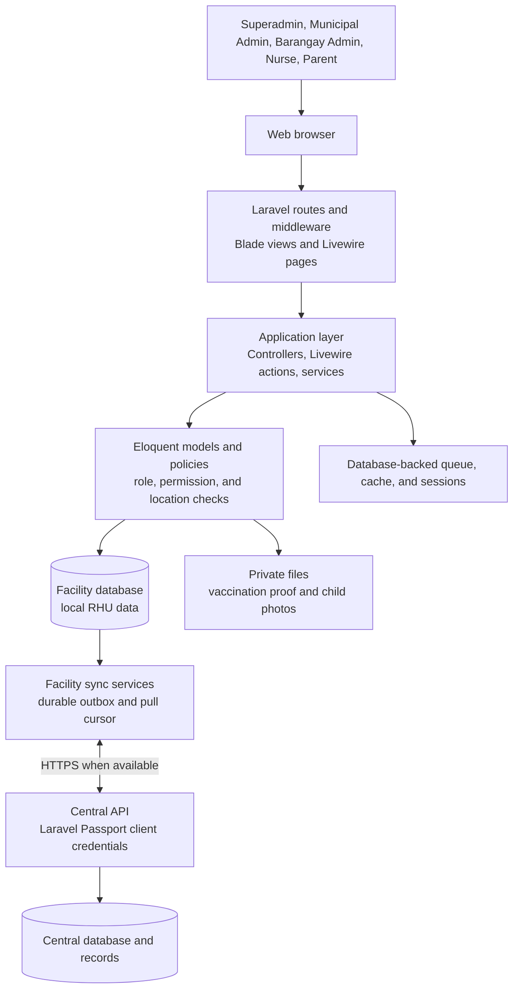

# System Architecture and Project Development

## Defense Guide for the Child Vaccination Management System

This guide explains the architecture visible in the current CVMS codebase and gives panel-ready wording about how the project was developed. It distinguishes implemented design from assumptions about the development process.

## 1. System overview

CVMS is a **modular Laravel monolith**: one Laravel application contains the user interface, application logic, data models, and integration services. It is not built as a set of independent microservices.

The same codebase can be configured as a **local facility/RHU instance** or a **central instance** using `APP_INSTANCE_TYPE`. The facility instance is designed to keep clinic work local and synchronize selected data with the central server when a connection is available.

## 2. Main architectural layers

### Presentation layer

- Laravel routes direct requests to controllers or Livewire pages.
- Blade templates provide page layouts, forms, tables, and report views.
- Livewire provides interactive server-backed screens for dashboards, child records, schedules, reports, inventory, and sync monitoring.
- Tailwind CSS and Vite support the frontend styling and asset build.

### Application and service layer

- Controllers handle HTTP workflows such as record submissions, reports, PDF exports, and API endpoints.
- Livewire components handle interactive screen state and authorize page access.
- Services hold reusable application operations, including vaccine schedule suggestions, missed-dose/demand calculations, submissions, inventory, notifications, and facility synchronization.

### Data layer

- Eloquent models represent users, child profiles, vaccination records, vaccine types and schedules, inventory transactions, population backgrounds, notifications, audit records, and synchronization state.
- Database migrations define and evolve the relational schema.
- Relationships connect children to vaccination records and linked parents, and connect locations through barangay, municipality, province, and region.
- The connection is environment-configurable. The example environment uses SQLite for a local facility setup; the project configuration also supports database-backed deployments such as MySQL.

### Integration layer

- Email and SMS adapters support parent reminders and account workflows, subject to deployment configuration.
- PDF services generate reports and vaccine cards.
- QR-code support provides a way to validate vaccine-card links.
- The facility-central integration uses HTTPS API endpoints protected by Laravel Passport client-credentials tokens and scoped sync access.

## 3. Facility and central deployment model

The architecture uses the same Laravel codebase in two operating modes:

| Mode | Main purpose | Relevant behavior |
|---|---|---|
| **Facility** | Local RHU/clinic operations | Local accounts and records; local workflows continue without central connectivity; selected changes are queued for synchronization; facility activation and setup are available. |
| **Central** | Multi-facility coordination | Central facility registration and activation; sync API endpoints; consolidated copies of selected facility data and central-owned reference information. |

`APP_INSTANCE_TYPE` controls which mode-specific routes and interfaces are registered. It is a deployment selector, **not an authentication or security control**. Authentication and authorization are handled separately by user access checks and API token validation.

### Synchronization flow

1. A facility user records or updates supported local data.
2. When offline synchronization is enabled, the application queues a durable event in the local outbox.
3. When synchronization runs, the facility requests a short-lived scoped token from the central server.
4. The facility pushes pending events in batches. Vaccination proof files are uploaded through a protected proof endpoint.
5. The facility pulls central-side updates using a saved cursor, then applies received records and advances the cursor.
6. Outbox statuses and sync history let staff review pending, failed, and completed work.

The current code synchronizes selected entities such as child and immunization records, facility staff metadata, guardian and child links, inventory transactions, appointments, audit events, and notification requests. Central-to-facility data includes vaccine reference data and schedule rules, along with supported parent records and requests. It is **not a replication of every database table**. Credentials are not part of the facility staff metadata payload.

### Offline behavior

The example environment sets `DB_CONNECTION=sqlite` and `OFFLINE_ENABLED=true`, which is suitable for a local demonstration/configuration. Those values can be changed for deployment. Offline capability means the configured facility instance can save local work and queue supported updates; synchronization requires connectivity and a valid facility activation. Do not claim that remote sync occurs while the network is unavailable.

## 4. Access control and data protection

- The application has Superadmin, Municipal Admin, Barangay Admin, Nurse, and Parent roles.
- Authorization checks also consider nurse permissions and assigned locations.
- Parents are limited to children linked to their account.
- Parent-submitted vaccination records pass through a staff verification workflow.
- Facility sync uses machine credentials and scoped tokens rather than exposing sync credentials in browser code.
- Audit and sync records help track changes and synchronization results.
- Parent privacy acknowledgment is part of the authenticated parent workflow.

These controls are part of the application design. They do not remove the need for secure server configuration, HTTPS, backup procedures, account administration, and proper handling of health information in production.

## 5. Functional areas developed

The current project includes these major feature areas:

1. **Accounts and role access:** authentication, account activation, profile/security settings, roles, nurse permissions, and location assignment.
2. **Child and family records:** child profiles, parent links, photos, timelines, vaccine cards, and vaccination history.
3. **Immunization workflow:** schedule rules, next-dose suggestions, parent submissions, proof review, and verification status.
4. **Operations:** vaccine inventory, reminders/notifications, audit records, reports, population-background records, and synchronization monitoring.
5. **Analytics:** vaccine-demand estimates and missed-dose follow-up scores, implemented as rule-based calculations.
6. **Facility-central integration:** facility activation, selected push/pull synchronization, event tracking, and proof transfer.

Some code for announcements, duplicate management, AEFI reporting, and a standalone defaulter page is present but their user-facing routes are currently disabled or not registered. Refer to the [Features Available per Role defense guide](features-per-role-defense-guide.md) for that distinction.

## 6. How the project was developed

### What the repository supports saying

The source shows an **incremental, feature-oriented development structure**. The data schema is managed with migrations; business operations are separated into services; user-facing tasks are organized as Laravel routes, controllers, Livewire pages, and Blade views; and permissions are enforced in application logic. Automated test files are also present in the repository.

The repository does not establish a formal project-management methodology such as Scrum, Agile, or Waterfall. Unless the client has separate planning records confirming one, describe the development as **iterative and module-based**, rather than claiming a formal methodology.

### Development phases that can be explained

These phases describe how the implemented modules fit together; they should not be presented as a verified calendar of the student’s actual work unless supported by her project records.

1. **Requirements and role definition:** identify user groups, their responsibilities, and the location boundaries for records.
2. **Data and database design:** define child, guardian, vaccination, schedule, inventory, population, and synchronization records; create and update the schema through migrations.
3. **Core workflows:** implement child registration, parent linking, vaccination recording, parent submissions, verification, and schedule guidance.
4. **Role-specific interface:** expose dashboards, forms, and operational screens according to role, permission, and service area.
5. **Operational modules:** add inventory, reminders, reports, population context, audit history, and PDF/QR outputs.
6. **Offline and central integration:** add facility activation, durable local sync events, central API exchange, and sync-status monitoring.
7. **Analytics and review:** add rule-based forecast and follow-up scoring, present outputs as advisory, and document data limitations.

### Example of an iterative and incremental SDLC approach

“Incremental” means delivering the system in usable feature groups. “Iterative” means reviewing and refining those groups as the work progresses. An example sequence for this project is:

1. **First increment — foundation:** user roles, authentication, and child profiles.
2. **Second increment — immunization workflow:** vaccination records, dose schedules, and next-dose suggestions.
3. **Third increment — parent and clinic workflow:** parent submissions, proof uploads, and staff verification.
4. **Fourth increment — operations and oversight:** vaccine inventory, reports, and population-background records.
5. **Fifth increment — extended capabilities:** offline synchronization and predictive analytics.

After each increment, the team can review whether the features work for the intended users, gather feedback, correct issues, and refine the next increment. Use this as the project’s SDLC description only if it matches how the student actually developed the system. The repository supports a modular, incremental description, but it does not prove a particular feedback or review cadence.

**Example panel wording:**

> “We used an iterative and incremental SDLC approach. We developed the system in functional increments, reviewed each set of features, and refined the system as requirements became clearer. For example, we established user roles and child records first, then added vaccination workflows, reporting and inventory, and later synchronization and analytics.”

## 7. Recommended wording for the panel

> “The CVMS uses a modular Laravel monolith with a web interface built from Blade and Livewire. The application separates presentation, request handling, reusable services, and Eloquent data models. It supports role- and location-based access. The same codebase can run as a local facility instance or a central instance. The facility stores supported clinic work locally and uses a durable outbox to synchronize selected records with the central API when connectivity is available. The system was developed incrementally by feature area, using database migrations, application services, role-specific screens, and automated tests. We describe the development as iterative and module-based because the repository does not document a formal Scrum or Waterfall process.”

## 8. Key messages to remember

- **Architecture name:** modular Laravel monolith, with configurable facility and central deployment modes.
- **Interface:** Laravel routes/controllers, Blade, and Livewire; Tailwind and Vite support the frontend.
- **Data:** relational models with database migrations and Eloquent relationships.
- **Offline pattern:** local facility database plus durable outbox and cursor-based pull/push sync for selected data.
- **Security:** roles, permissions, location scope, and Passport-protected machine-to-machine synchronization.
- **Development description:** incremental and module-based is supported by the code organization; do not claim Scrum/Waterfall without project records.
- **Analytics limitation:** the current forecast and missed-dose score are rule-based advisory calculations, not trained AI models.
- **Population limitation:** census/population-background data is not currently an input to the vaccine-demand formula.

## 9. Suggested conclusion

> “The project brings child vaccination records, schedule support, clinic workflows, parent submissions, inventory information, reports, and selected offline synchronization into one role-aware system. Its architecture keeps application modules in one Laravel codebase while supporting both local facility work and central coordination. The design provides a foundation for RHU operations, while the defense should clearly state the boundaries of enabled features, the selected records synchronized, the current registry-based forecast scope, and the advisory nature of the predictive outputs.”

## 10. Source files reviewed

- `composer.json` and `package.json` — framework and frontend dependencies.
- `config/system.php`, `config/offline.php`, and `.env.example` — instance mode and local/offline defaults.
- `routes/web.php` and `routes/api.php` — mode-specific pages and central sync endpoints.
- `app/Models/User.php` — roles, permissions, and geographic access scope.
- `app/Services/OfflineSyncService.php`, `FacilitySyncService.php`, `FacilityPushSyncService.php`, and `FacilityPullSyncService.php` — facility synchronization workflow.
- `config/sync.php` — selected synchronization entity definitions and ownership directions.
- `database/migrations/` and `app/Models/` — schema evolution and domain records.

*This document describes the repository implementation for academic discussion. Verify the exact `.env`, enabled routes, nurse permissions, and services in the deployed defense environment before presenting them as active.*
